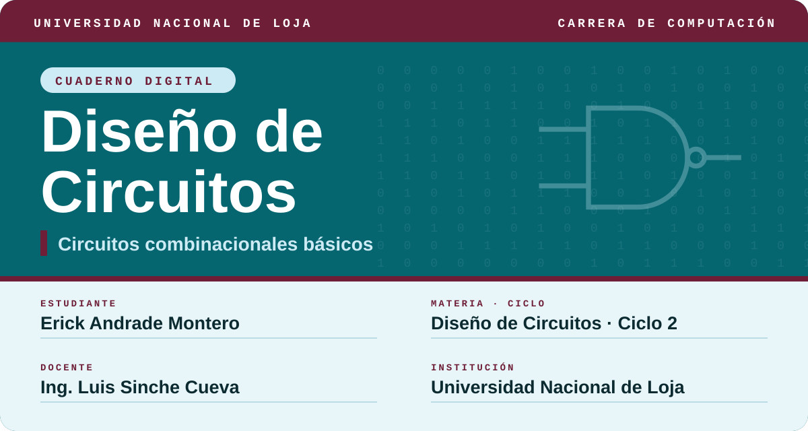
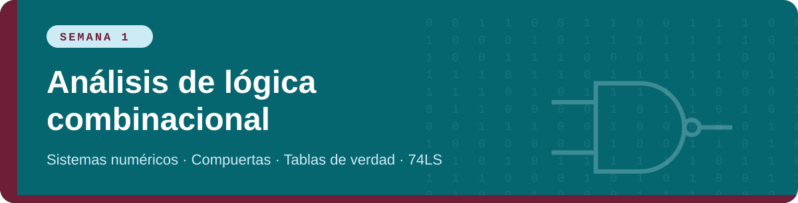
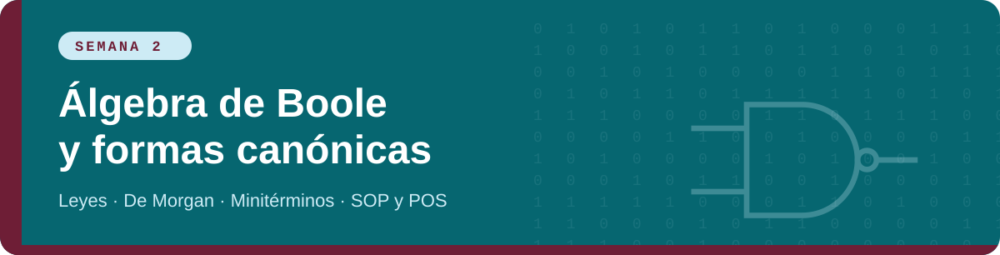
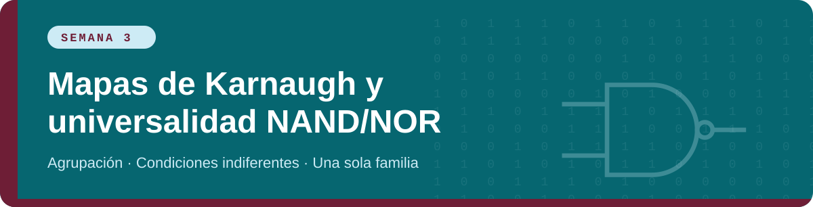
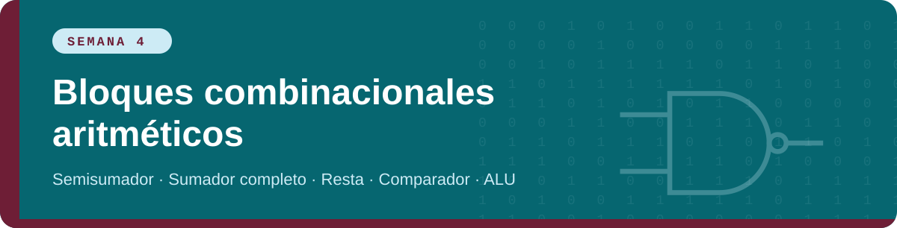
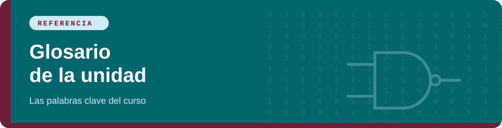

     

<h2 align="center">Contenido</h2>

Sistemas numéricos, aritmética binaria, complemento a dos, BCD, Gray, ASCII, compuertas, tablas de verdad y hoja de datos del 74LS.

Postulados y leyes, De Morgan, simplificación algebraica, minitérminos, maxitérminos, suma de productos y producto de sumas.

Mapas de 3 y 4 variables, condiciones indiferentes, universalidad de NAND y NOR, implementación con una sola familia.

Semisumador, sumador completo, sumador paralelo, resta por complemento a dos, comparador de magnitud y ALU.

> **Notación usada.** `+` es OR, `·` es AND (a veces se omite: `AB`), `A′` es NOT A (también se escribe Ā), `⊕` es XOR y `⊙` es XNOR.

---

Diseño de Circuitos · Erick Andrade Montero · Universidad Nacional de Loja

