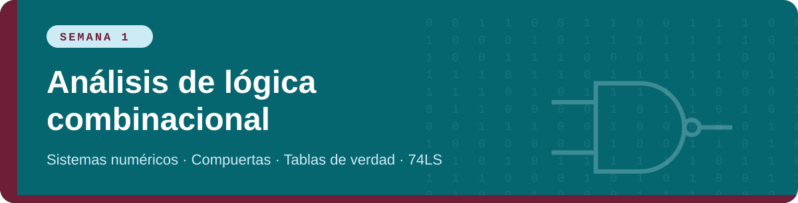

<p align="center"><a href="README.md"></a> <a href="semana-1.md"></a> <a href="semana-2.md"></a> <a href="semana-3.md"></a> <a href="semana-4.md"></a> <a href="glosario.md"></a> <a href="fuentes.md"></a></p>

<p align="center"></p>

Un circuito **combinacional** es aquel cuya salida depende solo de las entradas del momento. No tiene memoria. Esta semana se aprende el idioma con el que se escriben: sistemas numéricos, códigos y compuertas.

## 1. ¿Por qué todo es binario?

Un computador representa toda la información con **dos estados eléctricos**: un voltaje alto (1) y un voltaje bajo (0). Dos estados son fáciles de distinguir aunque haya ruido, por eso se prefieren a diez niveles de voltaje.

> [!NOTE]
> **Definición.** Un **bit** es un dígito binario (0 o 1). Un grupo de 4 bits es un **nibble** y uno de 8 bits es un **byte**.

## 2. Sistemas numéricos

| Sistema | Base | Dígitos | Detalle |
|:--|:-:|:--|:--|
| **Binario** | 2 | 0, 1 | Cada posición vale una potencia de 2: …16, 8, 4, 2, 1 |
| **Octal** | 8 | 0 a 7 | Cada dígito agrupa 3 bits |
| **Hexadecimal** | 16 | 0 a 9 y A a F | Cada dígito agrupa 4 bits |

> **Ejemplo resuelto**
>
> - **Binario a decimal:** `1011₂` = 1·8 + 0·4 + 1·2 + 1·1 = **11**.
> - **Decimal a binario** (divisiones sucesivas entre 2): 25 → residuos 1, 0, 0, 1, 1 leídos de abajo hacia arriba → `11001₂`.
> - **Binario a hexadecimal:** `1101 0110` → D y 6 → `D6₁₆`.
> - **Binario a octal:** `011 101 110` → 3, 5, 6 → `356₈`.

**Ejemplo con el decimal 25 en todos los sistemas y códigos:**

| Decimal | Binario | Octal | Hexadecimal | BCD | Gray | Compl. a dos (8 bits) |
|:-:|:-:|:-:|:-:|:-:|:-:|:-:|
| 25 | `11001` | `31` | `19` | `0010 0101` | `10101` | `00011001` |

## 3. Aritmética binaria y complemento a dos

Suma: `0+0=0`, `0+1=1`, `1+0=1`, `1+1=0` y llevo 1.

> **Ejemplo resuelto:** `0110 + 0111` (6 + 7)
>
> ```text
>   1 1 0   ← acarreos
>   0 1 1 0
> + 0 1 1 1
> ---------
>   1 1 0 1   = 13
> ```

> [!NOTE]
> **Definición.** El **complemento a dos** permite representar negativos. Para negar un número se invierten todos sus bits (complemento a uno) y se suma 1. Con *n* bits el rango es de −2ⁿ⁻¹ a 2ⁿ⁻¹ − 1.

> **Ejemplo resuelto:** −5 en 8 bits. 5 = `00000101` → invertir: `11111010` → sumar 1: `11111011`.
> Comprobación: 5 + (−5) = `00000101 + 11111011 = 1 00000000`; el bit 9 se descarta y queda 0.

## 4. Códigos binarios

> [!NOTE]
> - **BCD:** cada dígito decimal se codifica con 4 bits. 59 = `0101 1001`. Los patrones 1010 a 1111 no se usan.
> - **Gray:** entre un número y el siguiente cambia un solo bit. Se usa en encoders y en el orden de los mapas de Karnaugh. Se obtiene así: `gₙ = bₙ` y `gᵢ = bᵢ₊₁ ⊕ bᵢ`.
> - **ASCII:** 7 bits por carácter. 'A' = 65 = `1000001`; '0' = 48 = `0110000`.

| Dec | Binario | Gray | BCD |
|:-:|:-:|:-:|:-:|
| 0 | 0000 | 0000 | 0000 0000 |
| 1 | 0001 | 0001 | 0000 0001 |
| 2 | 0010 | 0011 | 0000 0010 |
| 3 | 0011 | 0010 | 0000 0011 |
| 4 | 0100 | 0110 | 0000 0100 |
| 5 | 0101 | 0111 | 0000 0101 |
| 6 | 0110 | 0101 | 0000 0110 |
| 7 | 0111 | 0100 | 0000 0111 |
| 8 | 1000 | 1100 | 0000 1000 |
| 9 | 1001 | 1101 | 0000 1001 |
| 10 | 1010 | 1111 | 0001 0000 |
| 11 | 1011 | 1110 | 0001 0001 |
| 12 | 1100 | 1010 | 0001 0010 |
| 13 | 1101 | 1011 | 0001 0011 |
| 14 | 1110 | 1001 | 0001 0100 |
| 15 | 1111 | 1000 | 0001 0101 |

## 5. Compuertas lógicas

> [!NOTE]
> **Definición.** Una **compuerta** es un circuito que realiza una operación lógica elemental sobre una o más entradas binarias y entrega una salida.

| Compuerta | Función | Se lee |
|:--|:-:|:--|
| **AND** | `A · B` | Vale 1 solo si todas las entradas valen 1 |
| **OR** | `A + B` | Vale 1 si alguna entrada vale 1 |
| **NOT** | `A′` | Invierte la entrada |
| **NAND** | `(A · B)′` | AND con la salida negada |
| **NOR** | `(A + B)′` | OR con la salida negada |
| **XOR** | `A ⊕ B` | Vale 1 si las entradas son diferentes (cuenta impar de unos) |
| **XNOR** | `(A ⊕ B)′` | Vale 1 si las entradas son iguales: detector de igualdad |

## 6. Tabla de verdad y hoja de datos del 74LS

Una **tabla de verdad** lista todas las combinaciones de entrada (2ⁿ filas para *n* entradas) y la salida que produce el circuito en cada una. Se escribe siguiendo el orden del conteo binario.

Los circuitos integrados de la familia **74LS** traen varias compuertas en un mismo encapsulado de 14 pines. En la hoja de datos se busca el diagrama de pines, la tabla de función (verdad), los voltajes de alimentación y los niveles lógicos.

| Circuito | Función | Compuertas |
|:--|:--|:--|
| **74LS08** | AND | 4 de 2 entradas |
| **74LS32** | OR | 4 de 2 entradas |
| **74LS04** | NOT (inversor) | 6 |
| **74LS00** | NAND | 4 de 2 entradas |
| **74LS02** | NOR | 4 de 2 entradas |
| **74LS86** | XOR | 4 de 2 entradas |
| **74LS266** | XNOR (colector abierto) | 4 de 2 entradas |

> [!WARNING]
> En la familia 74LS el pin **14 es Vcc (+5 V)** y el pin **7 es GND** en casi todos los integrados de 14 pines. Si los inviertes, el chip se calienta y se daña. Verifica siempre con la hoja de datos del fabricante, porque las excepciones existen.

## 7. Profundizando la clase

### 7.1 Las potencias de 2 que debes saber de memoria

| 2⁰ | 2¹ | 2² | 2³ | 2⁴ | 2⁵ | 2⁶ | 2⁷ | 2⁸ | 2⁹ | 2¹⁰ |
|:-:|:-:|:-:|:-:|:-:|:-:|:-:|:-:|:-:|:-:|:-:|
| 1 | 2 | 4 | 8 | 16 | 32 | 64 | 128 | 256 | 512 | 1024 |

Con ellas conviertes de binario a decimal sumando solo las posiciones que valen 1, y sabes cuántos valores distintos caben en *n* bits (2ⁿ).

> **Ejemplo resuelto**
>
> - **Binario a decimal:** `11010110` = 128 + 64 + 16 + 4 + 2 = **214**. Agrupado de 4 en 4 es `1101 0110` = D6 en hexadecimal; comprueba: 13·16 + 6 = 214.
> - **Decimal a hexadecimal:** 478 ÷ 16 = 29 residuo 14 (E); 29 ÷ 16 = 1 residuo 13 (D); 1 ÷ 16 = 0 residuo 1. Leído de abajo hacia arriba: **1DE₁₆**.

### 7.2 Niveles lógicos reales en la familia 74LS

Un 0 y un 1 lógicos son rangos de voltaje, no un valor exacto. Esto da margen frente al ruido eléctrico.

| Parámetro | Significado | Valor típico 74LS |
|:--|:--|:--|
| V<sub>CC</sub> | Alimentación | 5 V (4,75 a 5,25 V) |
| V<sub>IL</sub> máx. | Mayor voltaje de entrada que se lee como 0 | 0,8 V |
| V<sub>IH</sub> mín. | Menor voltaje de entrada que se lee como 1 | 2,0 V |
| V<sub>OL</sub> máx. | Voltaje de salida en nivel bajo | 0,5 V |
| V<sub>OH</sub> mín. | Voltaje de salida en nivel alto | 2,7 V |

> [!NOTE]
> Entre 0,8 V y 2,0 V una entrada queda en zona indefinida y la compuerta puede responder de forma impredecible. Confirma siempre estos valores en la hoja de datos de tu fabricante.

**Lógica positiva y negativa:** en lógica positiva el voltaje alto es el 1 (lo usual). En lógica negativa es al revés. Una compuerta AND en lógica positiva se comporta como OR en lógica negativa. Todo el curso usa lógica positiva.

### 7.3 Resumen de las siete compuertas

| A | B | AND | OR | NAND | NOR | XOR | XNOR | NOT A |
|:-:|:-:|:-:|:-:|:-:|:-:|:-:|:-:|:-:|
| 0 | 0 | 0 | 0 | 1 | 1 | 0 | 1 | 1 |
| 0 | 1 | 0 | 1 | 1 | 0 | 1 | 0 | 1 |
| 1 | 0 | 0 | 1 | 1 | 0 | 1 | 0 | 0 |
| 1 | 1 | 1 | 1 | 0 | 0 | 0 | 1 | 0 |

**Compuertas de más entradas.** Una AND de 3 entradas vale 1 solo en la fila 111. Una OR de 3 vale 0 solo en la fila 000. Una XOR de 3 entradas vale 1 cuando la cantidad de unos es impar: por eso se usa como generador de paridad.

### 7.4 Más códigos con ejemplos

> **Ejemplo resuelto**
>
> - **Binario a Gray:** el bit más significativo se copia y cada bit siguiente es la XOR entre el bit de arriba y el suyo. `1011` → 1, 1⊕0=1, 0⊕1=1, 1⊕1=0 → **1110**.
> - **Gray a binario:** se copia el primer bit y cada bit siguiente es la XOR entre el binario ya obtenido (el bit anterior) y el bit Gray. `1110` → 1, 1⊕1=0, 0⊕1=1, 1⊕0=1 → **1011**.
> - **ASCII de la palabra "Hola":** H = 72 = `01001000`, o = 111 = `01101111`, l = 108 = `01101100`, a = 97 = `01100001`.
> - **Suma en BCD (27 + 15):** `0010 0111 + 0001 0101`. Las unidades dan `0111 + 0101 = 1100`, que no es un dígito BCD válido (mayor que 9), entonces se suma `0110` de corrección: `1100 + 0110 = 1 0010`. Queda dígito 2 con acarreo 1. Las decenas: `0010 + 0001 + 1 = 0100`. Resultado: **`0100 0010` = 42**.

### 7.5 De un enunciado a una compuerta

> **Ejemplo resuelto: luz de pasillo con dos interruptores.** La lámpara cambia de estado cada vez que se acciona cualquiera de los dos interruptores. Con A y B como interruptores, la lámpara se enciende cuando *exactamente uno* está activo: `F = A ⊕ B`. Es una XOR. Si se quisiera que encienda cuando están en la misma posición, sería una XNOR.

### 7.6 Ejercicios de práctica con respuesta

<details><summary><b>a)</b> Convierte 37₁₀ a binario.</summary>

`100101` (32 + 4 + 1).
</details>

<details><summary><b>b)</b> Convierte 3F₁₆ a binario y a decimal.</summary>

`0011 1111` = 63.
</details>

<details><summary><b>c)</b> Escribe −6 en complemento a dos con 4 bits.</summary>

6 = `0110` → `1001` → +1 = `1010`.
</details>

<details><summary><b>d)</b> ¿Cuál es el BCD de 83?</summary>

`1000 0011`.
</details>

## 8. Preguntas clave para entender el tema

<details><summary><b>¿Por qué un computador usa solo dos estados y no diez?</b></summary>

Dos niveles de voltaje se distinguen con facilidad aunque haya ruido eléctrico; con más niveles los rangos se acercan y habría más errores.
</details>

<details><summary><b>¿Para qué sirven el octal y el hexadecimal si el computador solo usa binario?</b></summary>

Son una forma corta de escribir binario para las personas: cada dígito octal agrupa 3 bits y cada dígito hexadecimal agrupa 4.
</details>

<details><summary><b>¿Por qué el complemento a dos es mejor que usar solo un bit de signo?</b></summary>

Porque la misma suma binaria funciona para positivos y negativos, y el cero tiene una sola representación. Esto permite restar con el mismo circuito sumador.
</details>

<details><summary><b>¿Cuándo conviene Gray y cuándo BCD?</b></summary>

Gray cuando se necesita que entre valores consecutivos cambie un solo bit (encoders, mapas de Karnaugh). BCD cuando se quiere mostrar dígitos decimales, como en un display.
</details>

<details><summary><b>¿Cómo sé cuántas filas lleva una tabla de verdad?</b></summary>

2ⁿ, donde *n* es el número de entradas. Con 3 entradas son 8 filas y con 4 son 16.
</details>

<details><summary><b>¿Qué distingue a una XOR de una OR?</b></summary>

La OR también vale 1 cuando las dos entradas son 1; la XOR vale 0 en ese caso porque solo detecta que las entradas son diferentes.
</details>

<details><summary><b>¿Qué debo buscar primero en la hoja de datos de un 74LS?</b></summary>

El diagrama de pines (dónde están V<sub>CC</sub> y GND y las entradas y salidas de cada compuerta) y la tabla de función.
</details>

---

<p align="center"><a href="README.md"></a> <a href="semana-1.md"></a> <a href="semana-2.md"></a> <a href="semana-3.md"></a> <a href="semana-4.md"></a> <a href="glosario.md"></a> <a href="fuentes.md"></a></p>

<p align="center"><sub>Diseño de Circuitos · Erick Andrade Montero · Universidad Nacional de Loja</sub></p>
